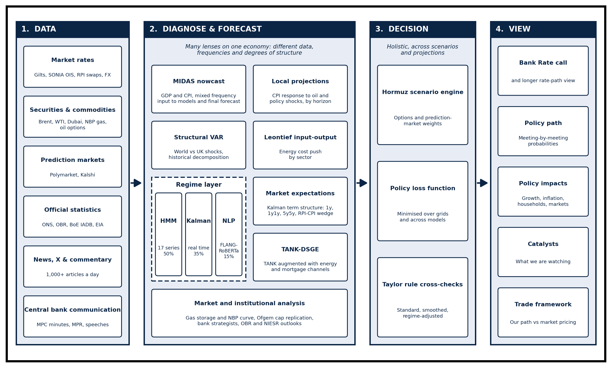
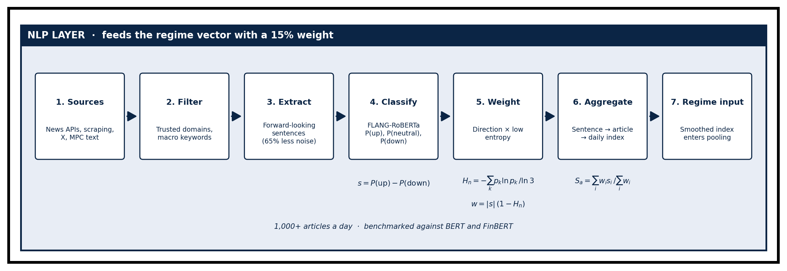
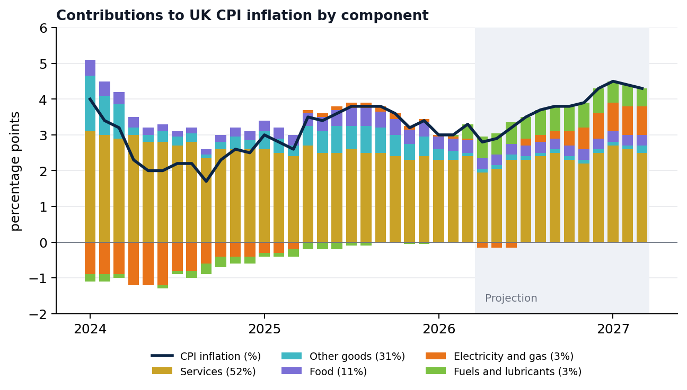
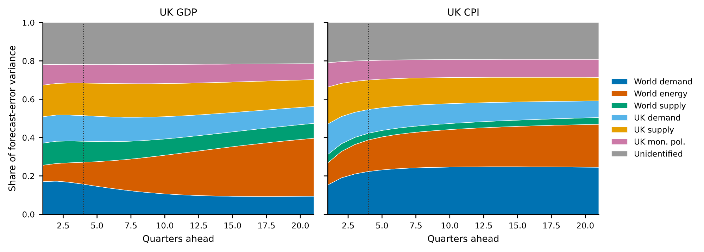
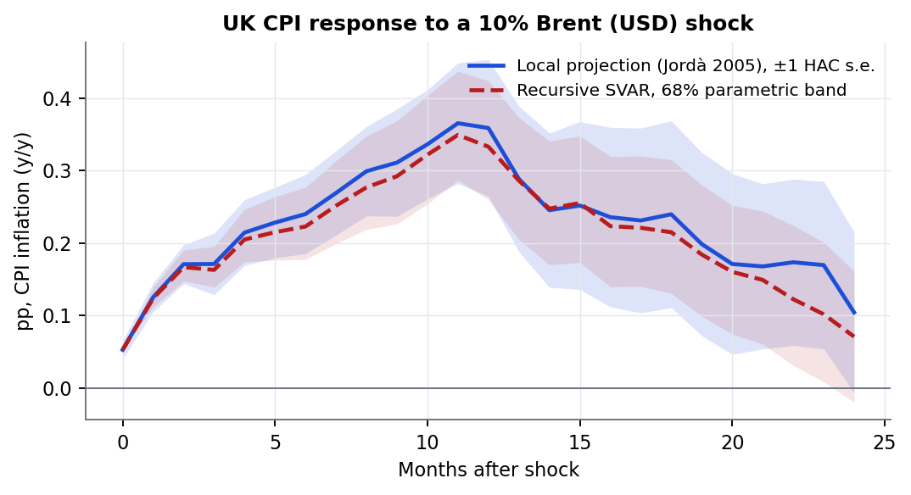
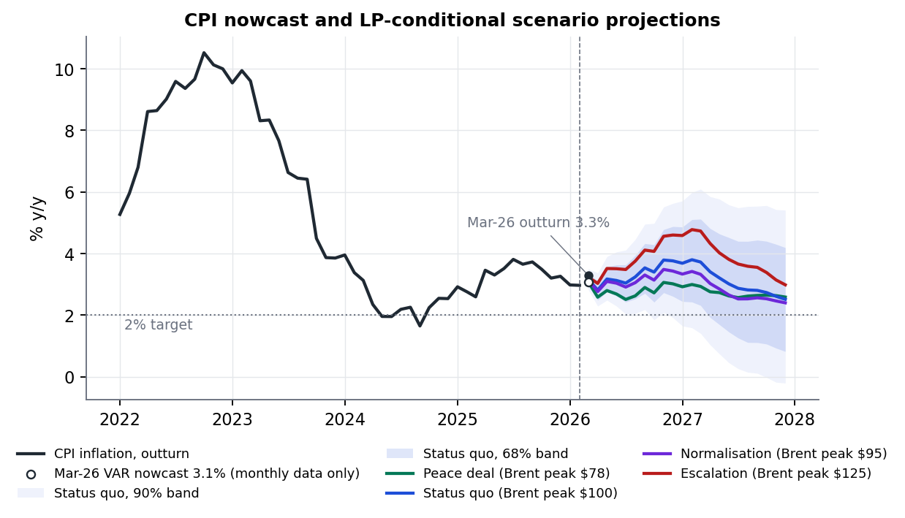
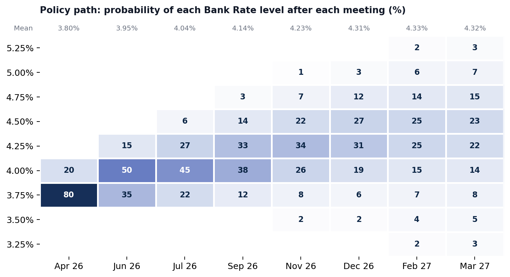

# UK Monetary Policy Under an Energy Shock: Forecasting and Policy Framework

**Citadel (Fixed Income & Macro) Central Bank Challenge 2026.**


> For the April 2026 MPC we called a HOLD at 3.75% with a conditional tightening bias. June is live, and it is our base case for the first hike.
>
> Against the curve: the market priced  70bp of tightening by end-2026 and three hikes to 4.50% by March 2027. We had 56bp for 2026, delivered earlier (June, July, September), and a March 2027 mean of 4.32% with a 45bp standard deviation. That points to paying the early 2026 meetings against later ones, a small receive in March 2027, and owning 2027 optionality.
>
> 5y5y held near 2.21% while the short end rose, so we treated the move as a headline problem with long-run credibility intact. The call flips if Brent stays at \$120 or more, or if wage growth runs above 4.5–5%.
>
> The page is frozen at the April 2026 information set and does not score the call against later meetings.

---

## Result

**WINNERS. 1st place, £15,000 team prize.**

| Name | University |
|---|---|
| Raul Saad Massoud | Imperial College London |
| Philip Stergiou | Durham University |
| Kriti Sharma | London School of Economics |
| Pedro Ramos Cervero | University of Warwick |


Final panel:

| Panel member | Role |
|---|---|
| Silvana Tenreyro | Chief Economist, IMF; former external MPC member |
| Angel Ubide | Head of Economic Research, Citadel |
| Michael Graham | Senior Portfolio Manager, Citadel |
| Saugata Sen | UK Economist, Citadel |

> "It all comes down to having a better read of the crystal ball than everybody else."

## About this repository

This is the public summary of our submission. The production suite stays private: code, models, data pipelines, calibrations and forecasts. What follows documents the architecture, the identifying assumptions and the evidence behind the call.

All figures, numbers, forecasts and charts on this page are illustrative. Nothing here is investment, trading or policy advice.

---

## Contents

1. [Executive summary](#executive-summary)
2. [Framework](#framework)
3. [Model suite at a glance](#model-suite-at-a-glance)
4. [Starting conditions](#starting-conditions)
5. [Models](#models)
   - [5.1 MIDAS nowcast](#51-midas-nowcast-of-gdp-and-cpi)
   - [5.2 Regime detection: HMM, Kalman and NLP](#52-multi-layer-regime-detection-hmm-kalman-and-nlp)
   - [5.3 Bayesian SVAR](#53-bayesian-svar-world-and-uk-shocks-behind-uk-cpi)
   - [5.4 Local projections and scenario projections](#54-local-projections-and-scenario-projections)
   - [5.5 Market and institutional analysis](#55-market-and-institutional-analysis-gas-the-ofgem-cap-and-outside-forecasts)
   - [5.6 Leontief input-output cost-push](#56-leontief-input-output-cost-push)
   - [5.7 Market-based inflation expectations](#57-market-based-inflation-expectations)
   - [5.8 Prediction markets and the Hormuz scenario engine](#58-prediction-markets-and-the-hormuz-scenario-engine)
   - [5.9 TANK-DSGE with energy and housing channels](#59-tank-dsge-with-energy-and-housing-channels)
   - [5.10 Policy optimisation under model uncertainty](#510-policy-optimisation-under-model-uncertainty)
6. [Policy decision](#policy-decision)
7. [Policy path](#policy-path)
8. [Market implications and trade framework](#market-implications-and-trade-framework)
9. [Public figures](#public-figures)
10. [Technology stack](#technology-stack)
11. [Limitations](#limitations)
12. [References](#references)
13. [Disclaimer](#disclaimer)

---

## Executive summary

**Recommendation for the April 2026 MPC: HOLD Bank Rate at 3.75%, with a conditional tightening bias.** We put 80% on a hold in April and 20% on a hike. June is live and is our base case for the first 25bp move, with half our probability mass at 4.00% after that meeting.

The open question was timing. A cut needs a durable Hormuz resolution and clear slack, and we do not see one in 2026.

The evidence:

1. **Regime.** The pooled regime vector reads Stagflation 66%, Demand shock 34%, Disinflation 0%. Our reading of MPC communication moved from a cut bias in December 2025 to a dovish hold in February 2026 and a firm hold in March.
2. **Energy pass-through leans up.** Our rule of thumb is about 40bp on CPI inflation for every sustained \$10/bbl rise in oil. In the local projections a 10% Brent (USD) shock raises CPI inflation by 0.37pp at its peak in month 11. Q3 CPI comes out at 4.2%, 4.3% and 4.8% across the three Hormuz scenarios.
3. **Long-term expectations are holding.** Smoothed March 2026 readings are 1y ≈ 2.53% and 5y5y ≈ 2.21%, and the anchoring gap (the model's expected-inflation level less 2%, net of risk premium and wedge; see §5.7) is about +0.09pp. The short end usually rises in a supply shock. With 5y5y stable we read this as a headline problem.
4. **Services are sticky, pay is slowing.** Services CPI is 4.5% and services contribute about 2.3–2.7pp of headline inflation on their own. Against that, AWE growth is 3.8% and falling and private-sector regular pay is +3.2%. The case for holding in April rests on that direction of travel; above 4.5–5% wage growth the decision flips to HIKE.
5. **Slack is opening, and mortgages are tightening policy for the MPC.** Unemployment is 4.9% with a forecast peak of 5.3–5.4%, and payrolled employees are down 65k on the year. Bank Rate sat at 0.1% until December 2021, so a large stock of cheap fixed-rate deals is still rolling off: 1.8m expire in 2026 and refix near 5.75%. 10y gilts are up 50bp.
6. **The loss minimum is HOLD.** We use a loss function parameterised following BoE staff work (MTP No.4). HOLD minimises expected loss under current conditions and in most cells of the oil × wage grid. The switch to HIKE comes near \$120 sustained Brent, and on the \$125 escalation path HIKE wins outright. Smoothed Taylor variants sit at 3.81% to 3.97%. Only the unsmoothed rule (4.40%, +65bp) asks for a move now.

**Where we differ from the market.** At submission the curve priced about 70bp of tightening by end-2026 and three hikes to 4.50% by the 18 March 2027 meeting. We have 56bp in 2026 total, delivered earlier (June, July, September), and a lower, wider 2027: our March 2027 mean is 4.32% with a 45bp standard deviation. The 2027 gap to the curve is 18bp, about 0.4 of our own standard deviation, so it is a modest edge; the timing view in 2026 is the stronger one.

**A note on the CPI paths.** Three sets of CPI numbers appear on this page, and they are conditioned differently. The call rests on the Hormuz scenario paths in §5.8 (Q3 CPI 4.2–4.8%, about 4.36% weighted by the options), which include the March data and the July Ofgem step. The outlook ranges under Starting conditions (Q3 3.5–4.0%, Q4 about 3.0%) are the broader summary ranges from our deck and sit below the scenario paths. The local-projection paths in §5.4 (Q3 CPI 2.7–3.8%) start from February data and leave out both the March jump and the cap step, so they sit lower still; read those for shape and spread. The component chart in §5.3 is an approximate reconstruction, not a forecast of record. Where the numbers disagree, the §5.8 paths govern.

---

## Framework



**Why so many models.** No single model gets the UK right in a shock like this one, so we built a mosaic. Each piece looks at the economy from a different angle and imposes a different amount of structure. At one end sit the data-driven tools: MIDAS reads high-frequency prices, local projections let the data speak horizon by horizon, and the text layer listens to what markets, commentators and the MPC are saying. At the other end, the SVAR and the TANK-DSGE force the numbers through economic theory and tell us why things move, not just how much. Market pricing, prediction markets and outside forecasts sit alongside both. Where the lenses agree, we lean on the answer. Where they disagree, we learn where the risk sits. Monetary policy is made under that kind of uncertainty, and we wanted our analysis to look at it the same way.

The suite runs left to right in four blocks.

**1. Data.** Six feeds: market rates (gilts, SONIA OIS, RPI swaps, FX); securities and commodities (Brent, WTI, Dubai, NBP gas, oil options); prediction markets (Polymarket, Kalshi); official statistics (ONS, OBR, BoE IADB, EIA); news, X and commentary at 1,000+ articles a day; and central bank communication (MPC minutes, the MPR, speeches).

**2. Diagnose and forecast.** The MIDAS nowcast does two jobs: it sets the starting point for the other models, and it goes out on its own as a published forecast of GDP and CPI. The structural VAR splits CPI and GDP into world and UK shocks. The regime layer pools an HMM, a real-time Kalman filter and an NLP text model. Alongside the models sits market and institutional analysis: gas storage and the NBP curve, Ofgem cap replication, bank strategist views and the OBR and NIESR outlooks. The Leontief input-output model maps energy costs through industries, local projections give the CPI response to oil horizon by horizon, a Kalman term-structure model reads market inflation expectations, and a TANK-DSGE supplies the mechanism.

**3. Decision.** We decide across scenarios and projections together, never from one model. The Hormuz scenario engine sets the weights from option and prediction-market prices. A policy loss function is minimised over oil × wage grids and across models. Taylor rules serve as cross-checks.

**4. View.** The output is a Bank Rate call with a longer rate-path view, a meeting-by-meeting policy path, the policy impacts on growth, inflation, households and markets, the catalysts we watch, and a trade framework built on our path against market pricing.

We take magnitudes from the reduced-form models and mechanism and direction from the structural model, then make the decision with a staff-parameterised loss evaluated across all of them.

---

## Model suite at a glance

| Block | Model | Question | Method | Based on | Key output |
|---|---|---|---|---|---|
| Diagnose & forecast | MIDAS nowcast | Where are GDP and CPI now? | Exponential-Almon MIDAS and U-MIDAS, ragged edge, daily energy data | Ghysels, Santa-Clara & Valkanov (2004); Foroni, Marcellino & Schumacher (2015) | Q1 2026 GDP +0.15% q/q; input to the models and a published forecast |
| Diagnose & forecast | Regime layer | Which macro regime, and how sure? | Gaussian HMM + Kalman filter + FLANG-RoBERTa text layer, pooled 50/35/15 | Hamilton (1989); Kalman (1960); Durbin & Koopman (2012); Shah et al. (2022); Liu et al. (2019); Araci (2019) | Stagflation 66% / Demand 34% / Disinflation 0% |
| Diagnose & forecast | Structural VAR | How much of CPI and GDP variance is world vs UK? | Bayesian SVAR, six sign-restricted shocks | Sims (1980); Kilian (2009); Uhlig (2005); Rubio-Ramírez, Waggoner & Zha (2010); BoE Technical Paper 3 | World shocks explain about half of CPI forecast-error variance at five years |
| Diagnose & forecast | Local projections | How does CPI respond to oil, horizon by horizon? | Jordà LP, 12 lags, HAC; scenario projection | Jordà (2005); Plagborg-Møller & Wolf (2021); Montiel Olea & Plagborg-Møller (2021); Li, Plagborg-Møller & Wolf (2024) | 0.37pp per 10% Brent shock at month 11 (recursive VAR benchmark 0.35pp) |
| Diagnose & forecast | Market and institutional analysis | When does gas reach CPI, and what do other forecasters see? | Ofgem cap replication from NBP forwards; storage; bank strategists; OBR and NIESR outlooks | Kilian (2009); Baumeister & Hamilton (2019) | July cap £1,877 / £1,941 / £2,053; unemployment peak 5.3% (OBR) / 5.4% (NIESR) |
| Diagnose & forecast | Leontief input-output | Which sectors carry the cost-push? | Leontief price model on ONS IOAT | Leontief (1936) | Chemicals, non-metallic minerals, utilities |
| Diagnose & forecast | Market expectations | Headline problem or credibility problem? | Four-factor Kalman term structure on RPI swaps and gilts, horizon-specific RPI-CPI wedge | Joyce, Lildholdt & Sorensen (2015); Kalman (1960); Durbin & Koopman (2012) | 5y5y ≈ 2.21%, anchoring gap ≈ +0.09pp |
| Diagnose & forecast | TANK-DSGE | What mechanism links energy, mortgages and policy? | Two-agent NK small open economy, energy and mortgage blocks, gensys + Kalman + RWMH | Galí, López-Salido & Vallés (2007); Bilbiie (2008); Burgess et al. (2013); Sims (2002); An & Schorfheide (2007) | Direction only: higher-for-longer under market expectations |
| Decision | Hormuz scenario engine | How likely is each Hormuz outcome? | De-vigged event contracts, isotonic CDF, option-implied density | Hansen & Sargent (2008); Kilian (2009) | 29% / 54% / 17%; prediction markets 46% on collapse |
| Decision | Policy loss | Which decision minimises expected loss? | Quadratic loss over oil × wage grids and across models; min-max check | BoE MTP No.4 (Alati et al. 2025); Svensson (2003); Brainard (1967); Hansen & Sargent (2008) | HOLD; flips at oil ≳ \$120 or wages > 4.5–5% |
| Decision | Taylor-rule cross-checks | What do simple rules prescribe? | Standard, smoothed, regime-adjusted and oil-conditional rules | BoE MTP No.1; Taylor (1993) | 3.81–3.97% smoothed; 4.40% unsmoothed |

---

## Starting conditions

April 2026, as submitted.

| Block | Reading |
|---|---|
| Activity | GDP Q4 2025 +0.1% q/q; MIDAS nowcast Q1 2026 +0.15% q/q; business investment −0.2% in 2026 |
| Inflation | CPI March 2026 3.3% y/y (up from 3.0%); services CPI 4.5% |
| Labour | Unemployment 4.9%; payrolled employees −65k y/y; regular pay +3.6%; private regular pay +3.2%; AWE 3.8% and falling |
| Housing | Bank Rate was 0.1% until December 2021 and many fixes were struck in 2021 at very low rates; 1.8m fixed-rate deals expire in 2026 and refix at an average 5y fixed rate near 5.75%; mortgage demand −13% y/y |
| Energy | UK imports ~40% of its energy; oil and gas prices +35% since the conflict began; gas storage at 3-year lows into injection season; Q2 2026 Ofgem cap £1,641/yr (−6.6% vs Q1) |
| Financial | QT reducing the gilt stock (£895bn to £531bn); 10y gilts +50bp |
| Geopolitics | 54 days with no Hormuz resolution at submission |

Outlook ranges: CPI 3.0–3.3% in Q1 2026, 3.0–3.5% in Q2 (the Ofgem dip), 3.5–4.0% in Q3, ~3.0% in Q4. Unemployment peaks at 5.3% (OBR March EFO) or 5.4% (NIESR). GDP growth ~0.7–0.9% in 2026.

Each refix raises monthly payments and cuts disposable income with no new move in Bank Rate, and that passive tightening is still in the pipeline through 2026. The 5.75% is the average 5y fixed rate as quoted in our deck at submission. We have not sized the payment increase or the hit to disposable income for this page, so treat the channel as a direction rather than a magnitude.

---

## Models

### 5.1 MIDAS nowcast of GDP and CPI

The nowcast sets the starting point before the structural layers run, using every observation released up to the forecast date. We also publish it directly as our near-term forecast.
**Based on:** Ghysels, Santa-Clara & Valkanov (2004); Foroni, Marcellino & Schumacher (2015).

Quarterly GDP and monthly CPI arrive with a lag. Energy prices move every day, and in March 2026 they moved sharply.

**Specification.** For a low-frequency target $`y_t`$ (quarterly GDP growth or monthly CPI inflation) and regressors $`x^{(m)}_{i}`$ sampled $`m_i`$ times per period:

```math
y_{t+h} = \beta_0 + \sum_{i=1}^{N} \beta_i \sum_{j=0}^{K_i-1} w_i(j;\theta_i)\, x^{(m_i)}_{i,\,t-j/m_i} + \sum_{p=1}^{P} \lambda_p\, y_{t-p} + \varepsilon_{t+h},
```

with the exponential Almon polynomial

```math
w(j;\theta_1,\theta_2) = \frac{\exp(\theta_1 j + \theta_2 j^2)}{\sum_{k=0}^{K-1}\exp(\theta_1 k + \theta_2 k^2)}.
```

Each block costs two shape parameters and one scale, whatever the lag length. The weights sum to one, so $`\beta_i`$ is the total effect of block $`i`$. Nonlinear least squares estimates $`(\beta,\theta,\lambda)`$. Where the frequency ratio is small (monthly into quarterly), U-MIDAS gives each lag its own OLS coefficient: $`y_{t+h} = \beta_0 + \sum_{j} \gamma_j\, x^{(m)}_{t-j/m} + \varepsilon_{t+h}`$.

**Ragged edge.** Each indicator's lag window starts at its own last release. We set $`h`$ per vintage and re-estimate the same equation for each information set. Missing high-frequency observations are not imputed; the window shifts back.

**Data.** Targets: ONS `ABMI`, `D7BT`, with `D7CH` and `D7EC` as components. Daily: EIA `RBRTE` Brent in sterling, NBP gas, road-fuel pump prices. Monthly: ONS activity, labour and price indicators; BoE SONIA.

The nowcast puts Q1 2026 GDP at +0.15% q/q, after +0.1% in Q4 2025. For comparison, a plain monthly VAR nowcasts March 2026 CPI at 3.07% against a 3.3% outturn, about 0.2pp short. Its information ends at the February average, so it cannot see the March Brent jump. That miss is why the nowcast runs on MIDAS with daily Brent, NBP and pump prices. It shows what monthly data leave out; it is not evidence on MIDAS accuracy, and we do not report a MIDAS CPI nowcast or a pseudo-real-time error record here.

We chose MIDAS because time aggregation throws away the within-period path, and that is where an energy shock sits. A dynamic factor model needs a joint model for every series; MIDAS keeps one equation per target and re-estimates quickly. Bridge equations need a forecast of the missing months, while MIDAS uses the daily data that are already observed.

### 5.2 Multi-layer regime detection: HMM, Kalman and NLP

This layer classifies the UK macro state as Stagflation, Demand shock or Disinflation and passes the regime vector to the Taylor-rule and loss layers.
**Based on:** Hamilton (1989); Kalman (1960); Durbin & Koopman (2012); Shah et al. (2022) FLANG; Liu et al. (2019) RoBERTa; Araci (2019) FinBERT.

The three layers run at different speeds. Structural data are slow and well identified, market signals are fast, and text is fastest of all. Text can show the reaction function shifting before the data do.

```math
p_{k,t} = 0.50\,p^{\text{HMM}}_{k,t} + 0.35\,p^{\text{KF}}_{k,t} + 0.15\,p^{\text{NLP}}_{k,t}, \qquad k \in \lbrace\text{Stag}, \text{Dem}, \text{Dis}\rbrace.
```

#### Layer 1: structural HMM

A Gaussian hidden Markov model on a standardised 17-variable monthly macro panel $`x_t`$. The latent state $`z_t \in \lbrace 1,\dots,K \rbrace`$ has transition matrix $`P_{ij} = \Pr(z_t=j \mid z_{t-1}=i)`$, and $`x_t \mid z_t=k \sim \mathcal{N}(\mu_k, \Sigma_k)`$. Baum-Welch (EM) estimates the parameters. The Hamilton filter gives

```math
\xi_{t|t} = \frac{\xi_{t|t-1} \odot \eta_t}{\mathbf{1}'(\xi_{t|t-1} \odot \eta_t)}, \qquad \xi_{t+1|t} = P'\xi_{t|t},
```

where $`\eta_t`$ stacks the state densities. After estimation, the signs of the inflation and activity means $`\mu_k`$ label each state, so the labels carry economic meaning.

#### Layer 2: real-time Kalman layer

A linear-Gaussian state space on higher-frequency signals (energy prices, market-implied inflation, activity nowcasts):

```math
y_t = Z\alpha_t + \varepsilon_t, \qquad \alpha_{t+1} = T\alpha_t + \nu_t.
```

Maximum likelihood via the prediction-error decomposition estimates the system. The HMM's regime-conditional distributions map the filtered inflation and growth momentum $`\alpha_{t|t}`$ to $`p^{\text{KF}}_{k,t}`$. This layer picked up the oil shock before the monthly panel did.

#### Layer 3: NLP communication and news layer

The text layer reads the MPC and the market narrative every day. We built it to give a clean, low-variance signal while staying inside API rate limits.



*The "65% less noise" label in the figure means 65% of content discarded at filtering and extraction. It is not an accuracy measure.*

**Ingestion.** Financial news through NewsAPI and GNews, full-text extraction with trafilatura, X/Twitter through the X API, and Bank of England communications (minutes, statements, speeches). Volume runs at 1,000+ articles a day.

**Filtering and key-sentence extraction.** A trusted-domain allow-list comes first, then a macro keyword filter (inflation, Bank Rate, wages, energy, gilts and related terms). The extractor then keeps forward-looking sentences only: expectation and outlook verbs, future tense, conditionals. Policy is about the path, so backward-looking description mostly adds noise. Ingestion and extraction together cut irrelevant content by 65%, which also keeps classifier calls inside the rate limits.

**Classifier.** FLANG-RoBERTa (Shah et al., 2022) is a RoBERTa-architecture model (Liu et al., 2019) pre-trained on financial text with finance-specific masking. Each sentence gets a three-class distribution $`p = (P_{\text{up}}, P_{\text{neu}}, P_{\text{down}})`$, where "up" means hawkish or inflationary. We compared it with BERT and FinBERT (Araci, 2019) during development, but we do not publish the label set or held-out scores, so read that comparison as qualitative.

**Score and confidence.**

```math
s = P(\text{up}) - P(\text{down}), \qquad H = -\sum_{i=1}^{3} p_i \log p_i, \qquad H_{\text{norm}} = \frac{H}{\log 3} \in [0,1],
```

```math
w = \lvert P(\text{up}) - P(\text{down}) \rvert \,(1 - H_{\text{norm}}).
```

The weight goes to zero if the up/down split is balanced (no direction) or if the prediction is uniform (no confidence). A sentence only counts when it is both directional and confident, and that keeps boilerplate and hedged central-bank language from swamping the signal.

**Aggregation.** Sentence to article, then article to day:

```math
S_{\text{article}} = \frac{\sum_i w_i s_i}{\sum_i w_i}, \qquad S_{\text{day}} = \frac{\sum_j W_j S_j}{\sum_j W_j},
```

where $`W_j`$ is the article weight. A rolling window smooths $`S_{\text{day}}`$ into $`\bar S_t`$. With entropy weighting, the daily index looked steadier in the short term than the BERT baseline. We have no published stability statistic behind that.

**Entry into the regime vector.** The text layer enters as an extra observation on the HMM. We fit a regime-conditional density $`f(\bar S_t \mid k)`$ on the HMM's historical labels and update the HMM prior by Bayes' rule:

```math
p^{\text{NLP}}_{k,t} = \frac{f(\bar S_t \mid k)\, p^{\text{HMM}}_{k,t}}{\sum_m f(\bar S_t \mid m)\, p^{\text{HMM}}_{m,t}}.
```

That ties the text layer to the structural labels and stops it inventing regimes of its own.

**MPC stance read.**

| Meeting | Read |
|---|---|
| Dec 2025 | Cut bias |
| Feb 2026 | Dovish hold |
| Mar 2026 | Firm hold |

The pooled read is Stagflation 66%, Demand shock 34%, Disinflation 0%. Before the conflict the HMM read disinflation. The Kalman layer flagged the oil shock and forward inflation risk first, and the text layer showed the MPC turning from easing to holding. The 66% stagflation probability feeds the regime-adjusted Taylor rule, which gives 3.86% (+11bp vs 3.75%).

**Limits.** The 50/35/15 weights are judgement. The layers are not independent: the NLP update uses the HMM as its prior and the Kalman layer maps through the HMM's regime-conditional distributions, so in practice the HMM carries more than its nominal 50%. A 17-dimensional full emission covariance is hard to estimate on a short sample, and a 0% state probability can signal near-singular densities; diagonal or factor covariances are safer. The three-class output needs a fine-tuned classification head on FLANG-RoBERTa. We do not report the label set or held-out scores against BERT and FinBERT here, and the 65% figure measures discarded content, not accuracy. Source mix drifts over time and the allow-list adds curation bias.

### 5.3 Bayesian SVAR: world and UK shocks behind UK CPI

This is the accounting layer. It sits between the HMM regime layer and the expectations module. It splits UK CPI inflation and GDP into world and domestic structural shocks, so we can say how much of the overshoot is imported and how much is home-grown.
**Based on:** Sims (1980); Kilian (2009); Uhlig (2005, *Journal of Monetary Economics*) on sign restrictions; Rubio-Ramírez, Waggoner & Zha (2010, *Review of Economic Studies*); BoE Technical Paper 3, as cited in our deck.

**What it has to explain.**



*Contributions to UK CPI inflation by component, January 2024 to early 2027. Weights: services 52%, other goods 31%, food 11%, electricity and gas 3%, fuels and lubricants 3%. An approximate reconstruction from Bank of England and ONS data, not a forecast of record. The shading starts in August 2026, but the information set ends with the March 2026 print, so everything from April 2026 on is projection. The chart smooths the July cap rather than showing it as a one-month step; §5.5 has the cap timing.*

Services carry most of the level, about 2.3–2.7pp of contribution throughout. Energy and fuels dragged in 2024 and turn into a positive contribution through 2026–27. In this reconstruction headline CPI rises toward about 4.5% at the turn of 2027; the quarterly path the call uses is the §5.8 one. The SVAR's job is to explain where that comes from.

**Specification.** A reduced-form VAR in a vector $`y_t`$ of world activity, world energy and non-energy prices, UK GDP, UK CPI and Bank Rate:

```math
y_t = c + \sum_{\ell=1}^{p} A_\ell\, y_{t-\ell} + u_t, \qquad u_t = B_0^{-1}\varepsilon_t, \qquad \mathbb{E}[\varepsilon_t\varepsilon_t'] = I .
```

The vector also carries further world activity and price series (see Data), so the system has more shocks than the six we name. We estimate it with Bayesian methods. The world block is ordered ahead of the UK block and rotations are drawn within each block, which makes the zero impact restrictions below hold exactly. For each posterior draw of $`(A, \Sigma_u)`$ we draw block-wise random orthogonal rotations $`Q`$ (Rubio-Ramírez, Waggoner & Zha, 2010) and keep the candidate impact matrix $`B_0^{-1} = \operatorname{chol}(\Sigma_u)\,Q`$ only if its impact responses match the signs below (Uhlig, 2005). A blank cell is unrestricted.

| Shock | Oil price | Non-energy world prices | World output | UK GDP | UK CPI | Bank Rate |
|---|---|---|---|---|---|---|
| World demand | + | + | + | + | + | |
| World energy | + | | − | − | + | |
| World supply | | − | + | + | − | |
| UK demand | 0 | 0 | 0 | + | + | + |
| UK supply | 0 | 0 | 0 | + | − | |
| UK monetary policy | 0 | 0 | 0 | − | − | + |

The pattern is the standard one. Demand shocks push output and prices the same way; supply shocks push them in opposite directions. An energy shock raises the oil price and CPI and lowers GDP. A world supply shock is signed on non-energy prices and leaves oil free, so it cannot be the mirror image of an energy shock. A monetary shock raises Bank Rate and lowers output and CPI. As a small open economy, the UK leaves world variables unchanged on impact. Variance from the shocks we do not name is reported as *unidentified*.

The FEVD is computed draw by draw and summarised by the posterior median. Medians taken cell by cell need not sum exactly to 100%.

```math
\omega_{ij}(h) = \frac{\sum_{s=0}^{h-1}\Theta_{s,[ij]}^2}{\sum_{k}\sum_{s=0}^{h-1}\Theta_{s,[ik]}^2}, \qquad \Theta_s = \Psi_s B_0^{-1}.
```

**Data.** UK CPI all items (ONS `D7BT`), UK real GDP (ONS `ABMI`), Bank Rate, Brent in USD (EIA `RBRTE`), plus world activity and price series.



The shares below are read off the figure, so treat them as approximate.

| Shock | UK CPI, 4 quarters | UK CPI, 20 quarters | UK GDP, 20 quarters |
|---|---|---|---|
| World demand | about 22% | about 24% | about 9% |
| World energy | about 17% | about 22% | about 30% |
| World supply | about 3% | about 3% | about 8% |
| UK demand | about 12% | about 9% | about 9% |
| UK supply | about 15% | about 12% | about 14% |
| UK monetary policy | about 10% | about 10% | about 8% |
| Unidentified | about 20% | about 19% | about 21% |

At five years, world shocks account for about half of the forecast-error variance of UK CPI, mostly through world demand and world energy. Energy's share of GDP variance keeps climbing with the horizon and reaches about 30% at 20 quarters: energy shocks stay in output longer than in prices. Monetary policy shocks explain about 10% of CPI variance at both horizons. That share measures policy surprises, not how far systematic policy can offset the other shocks, so we do not read it as a limit on what the MPC can do.

We use sign restrictions because attribution needs a system in which the shocks add up, and LP regressions do not provide one. Sign restrictions let us name an energy shock separately from a world demand shock without imposing a timing order we could not defend. The Bayesian setup carries parameter and rotation uncertainty through to the FEVD.

**Limits.** Sign restrictions set-identify the model. Many rotations fit, so the shares depend on the restrictions and on the implicit prior over rotations (Baumeister & Hamilton, 2019). About a fifth of the variance stays unidentified, and world supply is small and probably mixes several things. The model is linear with constant parameters over a sample that includes 2008, 2020 and 2022; the regime layer is there to catch the breaks it averages over.

### 5.4 Local projections and scenario projections

The local projections give a direct, horizon-by-horizon estimate of the CPI response to an oil shock. They supply the response function that turns Brent paths into CPI paths, and we check it against a recursive VAR benchmark.
**Based on:** Jordà (2005); Plagborg-Møller & Wolf (2021); Montiel Olea & Plagborg-Møller (2021); Li, Plagborg-Møller & Wolf (2024); Kilian (2009).

**Specification.** For each $`h = 0,\dots,24`$, one OLS regression:

```math
\pi_{t+h} - \pi_{t-1} = \alpha_h + \beta_h\, s_t + \sum_{\ell=1}^{12} \gamma_{h,\ell}' \, w_{t-\ell} + u_{t+h},
```

- $`\pi_t`$: CPI inflation built from `D7BT`. ONS CPI is not seasonally adjusted, so the m/m CPI and CPI energy series have their month-of-year means removed before estimation.
- $`s_t`$: Brent in USD (EIA `RBRTE`), % m/m. No contemporaneous controls enter, so $`\beta_h`$ is the response to the part of $`s_t`$ that the lagged information set does not predict. That is the same timing assumption as a recursive VAR with oil first.
- $`w_t = (s_t,\ \Delta\ln \text{CPI energy}_t,\ \Delta\ln \text{CPI}_t,\ i_t)'`$, 12 lags each, with $`i_t`$ the Bank Rate level.
- Newey-West HAC standard errors with bandwidth $`h+1`$ for the MA($`h`$) overlap; ±1 s.e. (68%) bands. The IRF $`\lbrace\beta_h\rbrace`$ is scaled ×10 to read per 10% shock.
- Extension, not estimated here: state dependence through an interaction, $`\beta_h s_t + \delta_h\, s_t\, p^{\text{stag}}_{t}`$, with $`p^{\text{stag}}_t`$ from the HMM. Each horizon stays linear in parameters.

**Recursive VAR benchmark.** Same data, same 12 lags, Cholesky ordering oil → energy CPI → CPI → Bank Rate. It exists only to check the oil response.

**Data.** Monthly, 1997-01 to 2026-02: EIA `RBRTE` (USD), ONS `D7BT` and `D7CH`, Bank Rate.



A 10% Brent shock raises CPI inflation by 0.37pp at the peak in month 11 and by 0.36pp at month 12. The recursive VAR benchmark gives 0.35pp at month 11 and 0.33pp at month 12. The two IRFs sit inside each other's 68% bands. Our rule of thumb of about 40bp per sustained \$10/bbl is the same order of magnitude, though the two are not directly comparable: one is a sustained dollar rise, the other a one-off percentage innovation, and the samples differ.

**Scenario projection.** With $`e_\tau`$ the % m/m innovations implied by a Brent path,

```math
\hat\pi^{\,\text{scen}}_{T+k} = \hat\pi^{\,\text{VAR}}_{T+k} + \sum_{\tau = 1}^{k} \frac{\beta_{\min(k-\tau,\,24)}}{10}\, e_{T+\tau}.
```

Beyond $`h = 24`$ the response is held at $`\beta_{24}`$. Bands come from 2,000 residual-bootstrap VAR paths and cover baseline forecast error only.



*February 2026 information set. The paths leave out the March Brent jump and the Ofgem step, so they start below the 3.3% March outturn. The "nowcast" in the figure title is the plain monthly VAR starting point, not the MIDAS nowcast. The outer band is wide because it reflects VAR baseline error on a sample that includes 2022.*

| Scenario | Brent peak | CPI 2026Q3 | CPI 2026Q4 | Peak | CPI 2027Q4 |
|---|---|---|---|---|---|
| Peace deal | \$78 | 2.7% | 2.9% | 3.1% | 2.6% |
| Normalisation | \$95 | 3.1% | 3.4% | 3.5% | 2.5% |
| Status quo | \$100 | 3.3% | 3.7% | 3.8% | 2.6% |
| Escalation | \$125 | 3.8% | 4.4% | 4.8% | 3.2% |

The 68% band is roughly ±1.0pp in 2026Q4. Because the paths start from February data, their levels sit below the Hormuz paths in §5.8; we use them for shape and spread. The construction treats each step of the Brent path as a fresh innovation, which over-counts oil persistence somewhat, and it holds sterling at its last level. Read the escalation path as leaning high on persistence. Sterling cuts the other way: a sustained oil shock with GBP weak against energy exporters such as NOK would add imported inflation that these paths leave out, and we have not sized that pass-through. Normalisation ends slightly below Peace deal in 2027Q4 (2.5% against 2.6%). That is a base effect of the construction: the retreat from its higher 2026 peak enters as a run of negative innovations, and those land on 2027 at the horizons where the response is largest.

We lead with local projections because the VAR extrapolates 12-lag dynamics out to $`h = 24`$, and errors in the lag structure compound. The LP estimates each horizon directly, which matters most when the regime is shifting. In population both estimate the same impulse responses (Plagborg-Møller & Wolf, 2021); in finite samples LPs trade lower bias for higher variance (Li, Plagborg-Møller & Wolf, 2024). Both use the same variables, lags and timing here, so agreement up to a year is close to mechanical. Beyond that, where the estimators can diverge, the agreement tells us more. Our bands use Newey-West HAC errors and do not implement lag augmentation. The lag-augmented LP with heteroskedasticity-robust errors (Montiel Olea & Plagborg-Møller, 2021) would give more reliable inference at long horizons and under high persistence, and it is the next robustness check.

### 5.5 Market and institutional analysis: gas, the Ofgem cap and outside forecasts

This block turns NBP forwards, storage and LNG exposure into a dated path for household energy bills and CPI energy. It also sets our numbers against bank strategists and the OBR and NIESR outlooks.
**Based on:** Kilian (2009) and Baumeister & Hamilton (2019) for energy as a supply shock; Ghysels, Santa-Clara & Valkanov (2004) for daily energy prices in the nowcast.

**Cap replication.** For delivery period $`c`$, Ofgem averages forward prices over an observation window $`\mathcal{O}_c`$:

```math
W_c=\frac{1}{|\mathcal{O}_c|}\sum_{t\in\mathcal{O}_c}\;\sum_{m\in\mathcal{D}_c}\omega_m\,F_t(m), \qquad \sum_m\omega_m=1,
```

with $`F_t(m)`$ the NBP forward for delivery month $`m`$ on day $`t`$ and $`\omega_m`$ a seasonal demand profile. The cap moves as $`\text{Cap}_c=\text{Cap}_{c-1}+\kappa\,(W_c-W_{c-1})+\Delta N_c`$, where $`\kappa`$ is wholesale pass-through and $`\Delta N_c`$ the change in network and policy costs. Partway through a window, realised days fix part of the answer:

```math
W_c=\tfrac{k}{|\mathcal{O}_c|}\,\bar F_{\text{obs}}+\Big(1-\tfrac{k}{|\mathcal{O}_c|}\Big)\,\mathbb{E}_s\!\left[\bar F_{\text{rem}}\right].
```

**CPI mapping.** The cap enters `D7CH` as a discrete step in the month it takes effect: $`\pi^{\text{cap}}_t\approx s_{\text{dom}}\,\Delta\ln\text{Cap}_c\,\mathbf{1}[t=\text{start}_c]`$. Motor fuels (`D7EC`) reprice from Brent within weeks. Gas reaches CPI only at the quarterly reset.

The Q2 2026 cap of £1,641/yr (−6.6% vs Q1) is a temporary dip; its window predates the conflict. July is the real reset: £1,877 / £1,941 / £2,053 across Rapid resolution / Limbo / Collapse, with $`\mathbb{E}[\text{Cap}]=\sum_s p_s\,\text{Cap}_s`$. Storage was at 3-year lows going into injection season. The separate oil and gas timings explain how headline CPI can dip in Q2 while the shock is still building.

**Outside views.** We read bank strategist notes and the OBR and NIESR outlooks as a check on our own numbers. The OBR's March EFO has unemployment peaking at 5.3% and NIESR at 5.4%, both above today's 4.9%.

**Limits.** Window dates, $`\omega_m`$ and $`\kappa`$ approximate Ofgem's published method. Fixed-tariff switching and government bill support are out of scope.

### 5.6 Leontief input-output cost-push

The input-output model maps the energy shock through the production network to sector costs.
**Based on:** Leontief (1936); Kilian (2009) for transmission context.

**Specification.** With $`a_{ij} = Z_{ij}/x_j`$ and primary cost $`v_j`$, cost-plus pricing gives

```math
p_j = \sum_i a_{ij}\,p_i + v_j \;\Longrightarrow\; p = (I - A^\top)^{-1} v = L^\top v, \qquad L = (I-A)^{-1}.
```

The shock raises primary cost in energy sectors $`E`$ (mining and quarrying incl. oil and gas; coke and refined petroleum; electricity and gas supply): $`\Delta v_j = \delta\, v_j \,\mathbf{1}[j \in E]`$. Then $`\Delta p = (I - A^\top)^{-1} \Delta v`$, with indirect effect $`\Delta p_j - \Delta v_j`$. A COICOP concordance $`B`$ and CPI weights $`w_k`$ bridge to consumer prices: $`\Delta \pi^{CPI} \approx \sum_k w_k (B\,\Delta p)_k`$.

**Identification.** Nothing is estimated. $`A`$ comes from the ONS industry-by-industry IOAT. Full, immediate pass-through with fixed coefficients makes $`\Delta p`$ an upper bound.

The largest cost pressures fall on chemicals, non-metallic mineral products and utilities. The VAR and LP layers size the shock; this model shows which industries carry it. That matters for persistence, because costs that pass through several pricing rounds can embed instead of fading with the commodity price.

### 5.7 Market-based inflation expectations

This module builds a CPI-consistent term structure of expectations from inflation-linked prices and hands an anchoring signal to the regime layer, the DSGE and the policy layer.
**Based on:** the nominal/real decomposition in Joyce, Lildholdt & Sorensen (2015), BoE Staff Working Paper 551, adapted to a Kalman factor model and extended for the 2030 RPI reform; Kalman (1960); Durbin & Koopman (2012).

**The RPI problem.** The MPC targets CPI, but index-linked gilts and UK inflation swaps pay on RPI, so every market breakeven is an RPI number. For a gilt breakeven at maturity $`n`$:

```math
\text{BEI}(n,t) = E_t\left[\pi^{CPI}_{t,n}\right] + w(n,t) + \rho(n,t) - \ell(n,t),
```

the CPI expectation we want plus the RPI-CPI wedge $`w`$ and the inflation risk premium $`\rho`$, less the liquidity premium $`\ell`$ on index-linked gilts.

**The wedge.** RPI has run 70–100bp above CPI. About 50–60bp is the formula effect: RPI averages prices arithmetically where CPI uses a geometric mean. The rest is housing, since RPI includes mortgage interest payments and CPI does not, so the wedge widens when mortgage rates rise.

**Liquidity from swaps.** Swaps carry no material liquidity premium, so at matched maturity the swap-minus-gilt breakeven identifies the gilt liquidity premium directly. Swaps also reprice daily, while the BoE gilt curves arrive with a lag.

**The 2030 reform.** In November 2020 the UK Statistics Authority confirmed that RPI will be aligned to CPIH from February 2030. The wedge then shrinks from 0.74pp to 0.28pp, the CPIH-CPI gap. One spot wedge is wrong for any contract that spans the reform, so we use a horizon-specific one:

```math
w(n,t) = \frac{m^{pre}_{n,t}\, w^{pre}_t + m^{post}_{n,t}\, w^{post}}{12n},
```

with $`m^{pre} = \min(12n,\ \text{months to Feb 2030})`$, $`m^{post} = 12n - m^{pre}`$, $`w^{pre}_t`$ the 12-month rolling mean of the realised wedge and $`w^{post} = 0.28`$pp. As of April 2026 the 5y5y window (2031–36) lies entirely after the reform. Subtracting the spot 0.74pp there would over-correct by 46bp and drag the anchoring gap down by the same amount.

**Forwards.** With $`s_n`$ the zero-coupon RPI swap rate at maturity $`n`$:

```math
\pi^{1y1y}_t = \frac{(1+s_{2,t})^2}{1+s_{1,t}} - 1, \qquad \pi^{5y5y}_t = \left(\frac{(1+s_{10,t})^{10}}{(1+s_{5,t})^{5}}\right)^{1/5} - 1.
```

We use the 1y point as a read on headline pass-through and 5y5y as a read on how persistent the market thinks inflation will be.

**State space.** Four latent factors, $`f_t = [\mu_t, \lambda_t, \rho_t, \ell_t]'`$: the level of expected CPI inflation, a Nelson-Siegel slope, the inflation risk premium and the gilt liquidity premium, each a stationary AR(1). The wedge comes off before measurement:

```math
y^{swap}_{n,t} - w(n,t) = \mu_t + g(n)\lambda_t + \rho_t + \varepsilon_{n,t}, \qquad y^{gilt}_{n,t} - w(n,t) = \mu_t + g(n)\lambda_t + \rho_t - \ell_t + \varepsilon_{n,t},
```

with $`g(n) = (1-e^{-n/\tau})/(n/\tau)`$. The gilt-swap spread pins down $`\ell_t`$ and the cross-maturity shape pins down $`\lambda_t`$. Level and risk premium load one-for-one, so persistence separates them: the premium mean-reverts faster than the near-permanent anchor. The Kalman filter drops missing tenors from the update and a smoother gives the full-sample states. Output: the anchoring gap $`\mu_t - 2\%`$.

Smoothed and wedge-adjusted, the March 2026 readings are 1y ≈ 2.53%, 5y5y ≈ 2.21%, anchoring gap ≈ +0.09pp. The gap is not 5y5y minus 2%. It is $`\mu_t - 2\%`$, so the smoothed level of expected CPI inflation is about 2.09%; the remaining 0.12pp or so of the 5y5y reading is the risk premium and slope terms at that horizon. We do not publish the split between those two. The short end moved more than the long end and 5y5y held. We read that as some de-anchoring at short horizons with the long-run anchor intact. In the policy layer the gap only lifts the effective target once it clears a threshold, and at +0.09pp it does not bind.

The 1y point sits well below our own CPI path (3.3% in March, 4.2–4.8% in Q3). Some of that is mechanical, from the wedge adjustment and the index lag in RPI swaps. The rest is a genuine disagreement: the market prices a faster fade of the energy shock than our scenarios do.

**Limits.** Nobody observes the risk and liquidity premia; loading and persistence restrictions identify them. The post-2030 wedge assumes the reform lands as announced. Swap liquidity is thinner at 1y. The model only reads market pricing; household and firm expectations are outside it.

### 5.8 Prediction markets and the Hormuz scenario engine

The scenario engine turns traded beliefs about the Strait of Hormuz into scenario weights for the CPI, cap and loss layers.
**Based on:** risk-neutral density from the second strike-derivative of call prices; Hansen & Sargent (2008) for weight robustness; Kilian (2009) and Jordà (2005) for the oil-to-CPI map.

**Contracts.** Polymarket and Kalshi binaries on weekly Hormuz tanker transits, Brent / WTI / Dubai price thresholds, and ceasefire or deal timing.

**De-vigging.** For exclusive outcomes with prices $`q_k`$, the overround is $`O=\sum_k q_k-1`$ and

```math
p_k=\frac{q_k}{\sum_m q_m}, \qquad \text{binary: } p=\frac{q^{\text{yes}}}{q^{\text{yes}}+q^{\text{no}}}.
```

**Thresholds to a CDF.** Each "above $`K_j`$" contract gives $`\hat F(K_j)=1-p_j`$. Isotonic regression (pool-adjacent-violators) enforces monotonicity across venues, then linear interpolation with flat tails.

**Options leg.** $`f_Q(K)=e^{rT}\,\partial^2 C(K,T)/\partial K^2`$ and $`F_Q(K)=1+e^{rT}\,\partial C(K,T)/\partial K`$, by finite differences on a smoothed implied-volatility smile. Scenario $`s`$ is a region of (Brent, transits, deal-timing) space. Oil options only price the Brent dimension, so the options weight is the mass of the scenario's Brent region, $`p_s=F(\bar K_s)-F(\underline K_s)`$. The transit and deal-timing dimensions come from the event contracts alone.

Scenario outcomes and weights, with the mapping to the Brent paths in §5.4:

| Hormuz scenario | §5.4 path(s) | Brent peak | Q3 CPI | July Ofgem cap | Options-implied weight (Brent region) | Loss-minimising April action |
|---|---|---|---|---|---|---|
| Rapid resolution | Peace deal, Normalisation | \$78 / \$95 | 4.2% | £1,877 | 29% | HOLD |
| Limbo | Status quo | \$100 | 4.3% | £1,941 | 54% | HOLD |
| Collapse | Escalation | \$125 | 4.8% | £2,053 | 17% | HIKE, if sustained |

Weighted by the options, Q3 CPI comes to about 4.36%.

Prediction markets put 46% on collapse; oil options put 17%. We read the gap at the time as hedging bias in commodity options that under-prices extreme outcomes. There is a fair argument the other way, since risk-neutral densities tend to over-weight adverse tails and prediction markets show a favourite-longshot bias. The likelier explanation is that the two price different events: a Brent region over an option expiry is not a venue's definition of "collapse" over its own resolution date, and neither is a physical probability. We kept both and treated the disagreement as model uncertainty. On our scenario distribution, 76% of the probability mass sat above the Bank's most recent published CPI projection at submission. We do not reproduce that projection here, so the figure is a direction of skew, not something a reader can check from this page.

Q3 CPI differs by only 0.1pp between Rapid resolution and Limbo, because much of the shock is already inside the Ofgem observation window for July, and motor fuels have already repriced. The scenarios separate in the July cap step, in Q4 and in 2027.

### 5.9 TANK-DSGE with energy and housing channels

This is the structural layer. It states the transmission mechanism and separates first-round from second-round effects.
**Based on:** Galí, López-Salido & Vallés (2007); Bilbiie (2008); Burgess et al. (2013) COMPASS; BoE MTP No.1; Sims (2002); An & Schorfheide (2007); Woodford (2003); Taylor (1993).

**Households.** Ricardian households follow a habit-augmented Euler equation. Hand-to-mouth households spend labour income net of mortgage service:

```math
c^o_t = a_f\,E_t c^o_{t+1} + a_b\,c^o_{t-1} - a_r\big(r_t - E_t\pi_{t+1} - E_t\gamma^z_{t+1} + \varepsilon^b_t\big),
```

```math
c^h_t = \tfrac{WL}{P_cC}\,(w_t + l_t - p^c_t) - \chi\, r^m_t, \qquad r^m_t = (1-\lambda)\,r^m_{t-1} + \lambda\, r^{fix}_t, \qquad c_t = \omega_o\,c^o_t + (1-\omega_o)\,c^h_t.
```

$`\lambda`$ is the share of the fixed-rate stock that refixes each quarter. Policy reaches hand-to-mouth spending only as deals roll off, which is the channel behind the 2026 refix wave.

**Firms and energy.** Energy enters both marginal cost and the CPI basket:

```math
mc^z_t = \alpha_{zz}\,p^v_t + (1-\alpha_{zz})\,p^e_t, \qquad p^c_t = (1-\alpha_{cz})\,p^e_t, \qquad \pi^z_t = \xi^b_Z\,\pi^z_{t-1} + \beta^f_Z\,E_t\pi^z_{t+1} + \kappa_Z\,mc^z_t + \mu^z_t.
```

Value added, wages, non-energy imports, energy imports and exports each have a hybrid Calvo curve. World energy follows $`p^{ef}_t = \rho_{pe}\,p^{ef}_{t-1} + \varepsilon^{pe}_t`$. Sterling follows UIP with a risk-premium shock.

**Policy and expectations.** $`r_t = \theta_r\,r_{t-1} + (1-\theta_r)[\theta_\pi\,\pi^{\text{ann}}_t + \theta_y\,\tilde y_t - \theta_E\,\text{econ}_t] + \varepsilon^r_t`$, where $`\text{econ}_t`$ is the energy contribution to CPI. Swap-implied 1y and 5y5y enter as measurement equations, $`\pi^{swap,h}_t = \sum_k w^h_k\,E_t\pi_{t+k} + e^h_t`$, and the anchoring gap from §5.7 shifts the effective target.

**Solution and estimation.** $`\Gamma_0 y_t = \Gamma_1 y_{t-1} + \Psi\varepsilon_t + \Pi\eta_t`$, solved with gensys (Sims, 2002), with a Blanchard-Kahn check on every draw. Kalman-filter likelihood; random-walk Metropolis-Hastings, $`\theta' = \theta + c\,\Sigma^{1/2}z`$ with $`\Sigma`$ the inverse Hessian at the mode. Built in Python and cross-checked in MATLAB/Dynare.

**Data.** Quarterly, demeaned growth rates: `ABMI`, consumption, investment, government spending, hours, trade, `D7BT`, `D7CH`, `D7EC`, AWE, sterling ERI, world GDP and CPI. Bank Rate (`IUQABEDR`) and world rates enter as demeaned levels.

We report the DSGE results qualitatively. CPI returns to target only gradually in the baseline and stays above target through 2027 in the shock scenario. Output weakens through the real-income channel, and mortgage transmission is still in the pipeline. Swapping rational expectations for market-based expectations moves the policy path toward higher-for-longer. We use the DSGE for direction and mechanism and do not publish its point outputs.

### 5.10 Policy optimisation under model uncertainty

This layer makes the Bank Rate decision by minimising expected loss across states and models. The MPC has no published loss function. Ours is parameterised following BoE staff work (MTP No.4), so read it as a staff parameterisation rather than the Committee's own objective.
**Based on:** BoE MTP No.4 (Alati et al. 2025); BoE MTP No.1; Taylor (1993); Woodford (2003); Svensson (2003); Brainard (1967); Hansen & Sargent (2008).

**Loss.**

```math
\mathcal{L}(i \mid s, m) = \mathbb{E}_t \sum_{h=0}^{H} \beta^{h}\Big[(\pi_{t+h}-\pi^*)^2 + \lambda\, y_{t+h}^2 + \mu\,(\Delta i_{t+h})^2\Big], \qquad \pi^* = 2\%.
```

$`\lambda`$ and $`\mu`$ come from MTP No.4. We do not tune them, and we do not reproduce their values here. The loss is symmetric and quadratic, so it cannot represent the post-2022 credibility asymmetry we argue for elsewhere (an overshoot that lasts costs more than its square suggests). That asymmetry enters our view through judgement, in the policy path, not through this function.

**Decision.** $`s = (\text{oil}, \text{wages})`$ runs over a grid; $`m`$ indexes the transmission models (LP/VAR projections, TANK-DSGE); $`i \in \lbrace\text{cut}, \text{hold}, \text{hike}\rbrace`$.

```math
i^{\star} = \arg\min_i \sum_{m} \omega_m \sum_{s} p_s\, \mathcal{L}(i \mid s, m), \qquad i^{\text{rob}} = \arg\min_i \max_{m} \sum_s p_s\, \mathcal{L}(i \mid s, m).
```

The spread across $`m`$ is multiplicative uncertainty, which argues for gradualism (Brainard, 1967). The min-max is the robust-control check (Hansen & Sargent, 2008).

HOLD minimises expected loss under the option weights at current conditions, and it is the loss-minimising action in most cells of the oil × wage grid. The switch to HIKE comes near \$120 sustained Brent; on the \$125 escalation path HIKE is optimal outright. The comparison is for the April action only. We do not publish the rate path assumed after it, and the switch points depend on that assumption. Three caveats:

- *Smoothing.* The $`\mu(\Delta i)^2`$ term penalises any move, so it tilts toward inaction. It does not lock in HOLD, since HIKE still wins under sustained escalation, but the switch points move with $`\mu`$ and $`\lambda`$. A $`\mu = 0`$ run is the right sensitivity check.
- *Scenario weights.* Under the prediction-market weight (46% on collapse) more mass sits in states where HIKE wins. We do not publish the expected-loss table by action, the HOLD-HIKE margin or the min-max result under each weighting, so the claim that HOLD survives the 46% weight is a qualitative finding here, not something a reader can check.
- *One meeting at a time.* The grid chooses among cut, hold and hike for April. It does not optimise over rate paths, so it cannot by itself say whether hiking in June beats hiking now. That comparison is the option-value argument under Policy decision, and it is judgement.

**Benchmark rule (MTP No.1).**

```math
i_t = \rho\, i_{t-1} + (1-\rho)\big[r^* + \pi^* + \phi_\pi(\pi_t-\pi^*) + \phi_y\, y_t\big], \qquad \rho = 0.91,\ \phi_\pi = 1.357,\ \phi_y = 1.072.
```

With $`\rho = 0.91`$ the smoothed rate is $`0.91 \times 3.75\% + 0.09 \times 4.40\% \approx 3.81\%`$, a small step toward the unsmoothed prescription. An earlier rule box in our deck gave 3.84%; the table below is internally consistent and supersedes it.

| Rule | Implied rate | Gap vs 3.75% |
|---|---|---|
| Standard (no smoothing) | 4.40% | +65bp |
| Smoothed ($`\rho = 0.91`$) | 3.81% | +6bp |
| Regime-adjusted (HMM 66% stagflation) | 3.86% | +11bp |
| Iran-conditional (\$125 oil) | 3.97% | +22bp |

The rules are cross-checks. The regime-adjusted rule raises the rate when stagflation probability is high, which cuts against the usual logic of looking through supply shocks, so we show it as an upper reference. The outputs depend on $`r^*`$ and output-gap inputs we do not publish; read the gaps in relative terms. With unemployment heading to 5.3–5.4%, the output gap should widen negatively through 2026 and pull the unsmoothed prescription down from 4.40%.

What comes out is a reduced-form reaction function under uncertainty, derived from a staff-parameterised loss rather than assumed up front.

---

## Policy decision

**HOLD at 3.75% in April, with a conditional tightening bias. June is live and is our base case for the first hike.**

Why hold in April:

- **Mortgages are already tightening.** Bank Rate sat at 0.1% until December 2021, and many fixed deals were struck in 2021 at very low rates. In 2026, 1.8m deals expire and refix at an average 5y fixed rate near 5.75%. Each refix lifts monthly payments and cuts disposable income without any new move in Bank Rate, and most of it is still to come. Add 10y gilts up 50bp and mortgage demand down 13% on the year.
- **Look through the first round, lean against the second.** The first-round effect of energy on the price level is no reason to move. Bank Rate is for second-round effects and any drift in expectations. Today 5y5y is stable and pay growth is falling, so the conditions for looking through still hold. Our identification does not cleanly separate oil supply from oil demand (see Limitations), so this rests on those two conditions.
- **The shock is also a real-income hit.** The UK imports about 40% of its energy. Unemployment is 4.9% with a forecast peak of 5.3–5.4%, and payrolled employees are down 65k. Slack is opening.
- **The costs are lopsided.** A premature hike piles a real-income squeeze on the energy hit and is costly to unwind. A hike delayed by one meeting can be made up while expectations hold. 5y5y can be a late signal, as the post-pandemic inflation showed, so if household or firm expectations rise while swaps stay flat we treat that as the earlier warning.

**Why June and not now.** June is our base case for the first hike, but at 50% it is a lean, not a certainty: we keep 35% on a June hold. Services CPI at 4.5%, the upside skew in the scenarios and a 66% stagflation read are what a +25bp dissent in April would rest on. They did not move the April loss minimum. Holding buys information. By June the July cap window will have closed, the April and May CPI prints and two labour-market releases will be in, the April pay settlements and the National Living Wage uprating will start to show in pay data, and the Decision Maker Panel will have reported firms' price expectations again.

The energy step on its own is not a reason to hike in June. It is first-round, we already expect it, and the look-through case covers it. What would take us to June is second-round evidence: services inflation staying near 4.5% as the energy contribution comes through, April settlements that keep regular pay from slowing further, or firm and household expectations rising while 5y5y sits still. If that evidence arrives, the conditions for looking through are weakening and an early move is cheaper than a late one. If it does not, the June hold is the outcome and nothing was lost by waiting. We did not re-run the loss grid on a projected June data set, so the 50% is our judgement on top of the April loss minimum, not a model output.

**The wage trigger.** AWE at 3.8% is already above the pay growth consistent with 2% inflation at normal productivity growth. The 4.5–5% figure is where the loss grid flips to HIKE today, not a target-consistent level, and taken alone it is a loose trigger. Direction is the earlier signal: for June, pay that stops falling from 3.8% is enough, alongside sticky services, to support the hike. We do not publish a settlements-based or productivity-adjusted unit labour cost read.

**What flips the call.** Brent at \$120 or more for a sustained period, or wage growth above 4.5–5%. Under sustained escalation (about \$125) HIKE minimises loss outright. Only a durable resolution with opening slack moves the path the other way, and the policy path in §7 puts that weight in 2027.

**Dashboard before June:**

| Indicator | What moves the call |
|---|---|
| CPI services (April and May prints) | Sticky or rising services inflation strengthens the June hike |
| Labour market release (AWE, regular pay) | A turn up in pay growth brings the hike forward |
| April pay settlements, National Living Wage uprating | Settlements that stop regular pay slowing are second-round evidence for June |
| Ofgem July cap (observation window closes before June) | A cap near the Collapse path confirms the energy step |
| Decision Maker Panel, household expectations | Rising firm or household expectations with flat swaps is the early warning |
| 5y5y swap forward | A sustained move up ends the look-through case |
| Brent, Hormuz transits | Sustained Brent ≳ \$120 makes a hike the clear choice |
| Mortgage refix pace | Faster pass-through of the 2026 refixes does some of the MPC's work |

---

## Policy path



Our probability (%) for each Bank Rate level after each MPC meeting, as of the April 2026 meeting:

| Level | Apr 26 | Jun 26 | Jul 26 | Sep 26 | Nov 26 | Dec 26 | Feb 27 | Mar 27 |
|---|---|---|---|---|---|---|---|---|
| 5.25% | | | | | | | 2 | 3 |
| 5.00% | | | | | 1 | 3 | 6 | 7 |
| 4.75% | | | | 3 | 7 | 12 | 14 | 15 |
| 4.50% | | | 6 | 14 | 22 | 27 | 25 | 23 |
| 4.25% | | 15 | 27 | 33 | 34 | 31 | 25 | 22 |
| 4.00% | 20 | 50 | 45 | 38 | 26 | 19 | 15 | 14 |
| 3.75% | 80 | 35 | 22 | 12 | 8 | 6 | 7 | 8 |
| 3.50% | | | | | 2 | 2 | 4 | 5 |
| 3.25% | | | | | | | 2 | 3 |
| **Mean (%)** | 3.80 | 3.95 | 4.04 | 4.14 | 4.23 | 4.31 | 4.33 | 4.32 |
| **Std dev (bp)** | 10 | 17 | 21 | 24 | 29 | 31 | 41 | 45 |
| **vs 3.75% (bp)** | +5 | +20 | +29 | +40 | +48 | +56 | +58 | +57 |

For each meeting $`m`$ and level $`k`$:

```math
\mathbb{E}[i_m]=\sum_k p_{m,k}\,k,\qquad \sigma_m=\Big(\sum_k p_{m,k}\,(k-\mathbb{E}[i_m])^2\Big)^{1/2}.
```

The probabilities are a judgement-weighted mapping from the Hormuz scenarios, the regime read and the loss grid to meeting outcomes. They are our own view; we did not back them out of market prices.

April is a hold at 80%, with a 20% hike tail. June carries half the mass at 4.00% and is our base case for the first 25bp. The hikes bunch in June, July and September, and expected tightening reaches about 56bp by December 2026. After that the mean barely moves, from 4.31% in December to 4.32% in March 2027, while the standard deviation keeps rising to 45bp. In 2027 the distribution opens both ways: cuts to 3.25–3.50% and hikes to 5.00–5.25% both carry weight.

**Market pricing at submission.** The curve priced about 70bp of tightening by end-2026, roughly 2⅘ hikes, and three hikes to 4.50% by the 18 March 2027 meeting.

**Our view against pricing.** For 2026 we land on the same total, but we deliver it earlier: most of our tightening is in by September. Into 2027 the market keeps hiking to 4.50%; our mean stalls at 4.32% and our distribution is much wider, with real weight on both a reversal and a further leg up.

---

## Market implications and trade framework

The April hold itself was largely priced, so tone, guidance and the vote split mattered most on the day. The more useful gap is in timing. Every trade below follows from our path against the curve: hikes earlier than priced in 2026, and a lower, wider distribution than priced in 2027. These are conditional framings with entry logic and invalidation. They are not backtested and carry no P&L.

| Trade | Direction | Entry logic | Invalidation |
|---|---|---|---|
| Front-loaded 2026 | Pay July 2026 meeting-dated OIS against receiving December 2026, DV01-matched | Our cumulative tightening is +29bp after July and +56bp after December. The curve has the same December total, so the edge is timing only, and an outright pay would also lose on a general dovish repricing. Enter while the July forward prices less than +29bp of the December +56bp, i.e. while the curve spreads the hikes later in the year than we do. | A June hold alongside oil easing toward the \$78 peace-deal path |
| Lower 2027 | Small receive in the March 2027 meeting | The curve prices three hikes to 4.50%; our mean is 4.32%. That 18bp is about 0.4 of our 45bp standard deviation, before any term premium in the forward, so it earns a small risk allocation at most. A cleaner version waits for a delivered June hike. | Oil moving toward the \$125 escalation path, or wage growth breaking above 5% |
| Wider 2027 | Long strangles on 2027 meeting dates (SONIA futures options or short-expiry payer/receiver swaptions) | Our standard deviation reaches 41–45bp in February and March 2027, with weight at both 3.25% and 5.25%. This only pays if our spread is wider than implied vol on those dates, which we do not publish, so as written it states our uncertainty rather than a measured edge. Held with the March 2027 receive, the book is net short rates; the strangle is close to delta-neutral at entry. | The distribution narrowing: a durable Hormuz outcome either way, with pay and services CPI settling |

**The awkward middle case.** A June hold with Brent near \$100 (the Status quo path) sits between our triggers. It marks the July/December flattener against us without disproving the view, since July stays live. We would cut the position unless the July data bring the second-round evidence described under Policy decision.

Price levels for entry and stops, the market's meeting-by-meeting pricing at submission and implied vol are not published here, so the table gives the logic, not the levels.

**Conditional overlays.** Two positions depend on the Hormuz scenario more than on the rate path. Under escalation, the 1y RPI swap should rise faster than 5y5y while the long-run anchor holds, which favours paying 1y against receiving 5y5y; the 2030 RPI reform affects only the 5y5y leg and the wedge model in §5.7 prices it. Under a sustained oil shock, sterling should underperform energy exporters, so GBP against NOK is the natural FX expression. Both unwind on a Brent reversal toward the peace-deal path. On the gilt curve, QT and the refix wave bear on 2s10s, which we treat as a view to watch rather than a trade.

**Medium and longer run.** We expect mortgage rates to drift lower but stay restrictive while the 2026 refix wave works through, and inflation risk to re-emerge in Q3 through energy pass-through. Further out, a persistent geopolitical risk premium, a move away from LNG toward renewables and nuclear, and higher public spending all lean against a quick return to low rates.

---

## Public figures

The figures on this page come from small illustrative scripts, separate from the production suite. Their results move with data revisions and package versions.

---

## Technology stack


---

## Limitations

- **Identification.** The SVAR is set-identified by sign restrictions, so its shares depend on the restrictions and the prior over rotations, and about a fifth of variance is unidentified. The LP shock is a recursive Brent (USD) innovation and pools oil supply with global demand (Kilian, 2009; Baumeister & Hamilton, 2019; Känzig, 2021). An external-instrument LP is the next step. Brent and NBP gas moved together in 2021–22, so the oil response may also carry some gas pass-through.
- **Seasonality.** The LP and the recursive VAR benchmark remove month-of-year means from the m/m CPI series. Changes in seasonal patterns over the sample are not modelled.
- **Sample and vintage.** The monthly LP sample ends in February 2026, before the March Brent jump. The linear, constant-parameter models span 2008, 2020 and 2022. No real-time out-of-sample evaluation of the MIDAS nowcast is reported here.
- **Scenario projection.** The LP construction over-counts oil persistence and holds sterling at its last level (§5.4).
- **Uncertainty bands.** Scenario bands cover VAR baseline error only. They leave out parameter and LP sampling error and understate total uncertainty.
- **Second-round evidence.** The expectations model reads market pricing only. Firm and household expectations enter the decision as judgement. We do not split services inflation into its wage-driven part, indirect energy pass-through and indexed or administered prices, so the services argument for June is a read of the level and its persistence, not a decomposition.
- **CPI paths.** Three sets of CPI numbers with different conditioning appear on the page (see the note in the executive summary). The §5.8 paths govern the call.
- **Decision.** The expected-loss table, the min-max result and the loss under prediction-market weights are not published here. The loss is evaluated for the April action only, and the June probability is judgement.
- **Judgement.** Regime pooling weights (50/35/15), model weights $`\omega_m`$ and the state grid are set, not estimated. HMM state labels are interpretive.
- **Text.** Source mix drifts, the allow-list adds curation bias, and the NLP likelihood inherits the HMM labels.
- **Market-implied probabilities.** Neither option densities nor event prices are physical probabilities. Event contracts are thin and definitions differ across venues.
- **Expectations.** Risk and liquidity premia are identified by restrictions. The post-2030 RPI wedge is an assumption.
- **Structure.** The DSGE is linear with a fixed two-agent split; energy and refixing shares are calibrated. The input-output model assumes full pass-through and gives an upper bound.
- **Policy path.** The meeting probabilities are a judgement-weighted mapping in 25bp steps. Market pricing is a snapshot at submission. A forward is not the market's expectation, so part of any gap between our mean and the curve may be term premium. The trade framings are not backtested, and carry and roll are not costed.

---

## References

**Nowcasting and state space**

- Durbin, J. and Koopman, S. J. (2012). *Time Series Analysis by State Space Methods.* Oxford University Press.
- Foroni, C., Marcellino, M. and Schumacher, C. (2015). Unrestricted mixed data sampling (MIDAS): MIDAS regressions with unrestricted lag polynomials. *Journal of the Royal Statistical Society: Series A.*
- Ghysels, E., Santa-Clara, P. and Valkanov, R. (2004). The MIDAS touch: Mixed data sampling regression models. Working paper, UCLA and UNC.
- Hamilton, J. D. (1989). A new approach to the economic analysis of nonstationary time series and the business cycle. *Econometrica.*
- Kalman, R. E. (1960). A new approach to linear filtering and prediction problems. *Journal of Basic Engineering.*

**Natural language processing**

- Araci, D. (2019). FinBERT: Financial sentiment analysis with pre-trained language models. arXiv preprint.
- Liu, Y. et al. (2019). RoBERTa: A robustly optimized BERT pretraining approach. arXiv preprint.
- Shah, R. S. et al. (2022). When FLUE meets FLANG: Benchmarks and large pretrained language model for financial domain. *Proceedings of EMNLP.*

**VARs, local projections and oil shocks**

- Baumeister, C. and Hamilton, J. D. (2019). Structural interpretation of vector autoregressions with incomplete identification: Revisiting the role of oil supply and demand shocks. *American Economic Review.*
- Jordà, Ò. (2005). Estimation and inference of impulse responses by local projections. *American Economic Review.*
- Känzig, D. R. (2021). The macroeconomic effects of oil supply news: Evidence from OPEC announcements. *American Economic Review.*
- Kilian, L. (2009). Not all oil price shocks are alike: Disentangling demand and supply shocks in the crude oil market. *American Economic Review.*
- Li, D., Plagborg-Møller, M. and Wolf, C. K. (2024). Local projections vs. VARs: Lessons from thousands of DGPs. *Journal of Econometrics.*
- Montiel Olea, J. L. and Plagborg-Møller, M. (2021). Local projection inference is simpler and more robust than you think. *Econometrica.*
- Plagborg-Møller, M. and Wolf, C. K. (2021). Local projections and VARs estimate the same impulse responses. *Econometrica.*
- Rubio-Ramírez, J. F., Waggoner, D. F. and Zha, T. (2010). Structural vector autoregressions: Theory of identification and algorithms for inference. *Review of Economic Studies.*
- Sims, C. A. (1980). Macroeconomics and reality. *Econometrica.*
- Uhlig, H. (2005). What are the effects of monetary policy on output? Results from an agnostic identification procedure. *Journal of Monetary Economics.*

**Inflation expectations**

- Joyce, M., Lildholdt, P. and Sorensen, S. (2015). Extracting inflation expectations and inflation risk premia from the term structure: A joint model of the UK nominal and real yield curves. Bank of England Staff Working Paper No. 551.

**Production networks**

- Leontief, W. W. (1936). Quantitative input and output relations in the economic system of the United States. *Review of Economics and Statistics.*

**DSGE**

- An, S. and Schorfheide, F. (2007). Bayesian analysis of DSGE models. *Econometric Reviews.*
- Bilbiie, F. O. (2008). Limited asset markets participation, monetary policy and (inverted) aggregate demand logic. *Journal of Economic Theory.*
- Burgess, S. et al. (2013). The Bank of England's forecasting platform: COMPASS, MAPS, EASE and the suite of models. Bank of England Working Paper No. 471.
- Galí, J., López-Salido, J. D. and Vallés, J. (2007). Understanding the effects of government spending on consumption. *Journal of the European Economic Association.*
- Sims, C. A. (2002). Solving linear rational expectations models. *Computational Economics.*

**Monetary policy and decision under uncertainty**

- Alati, A. et al. (2025). Bank of England Macro Technical Paper No. 4 (loss function), as cited in our deck.
- Bank of England. Macro Technical Paper No. 1 (smoothed policy rule), as cited in our deck.
- Bank of England. Technical Paper 3 (SVAR decomposition methodology), as cited in our deck.
- Brainard, W. (1967). Uncertainty and the effectiveness of policy. *American Economic Review, Papers and Proceedings.*
- Hansen, L. P. and Sargent, T. J. (2008). *Robustness.* Princeton University Press.
- Svensson, L. E. O. (2003). What is wrong with Taylor rules? Using judgment in monetary policy through targeting rules. *Journal of Economic Literature.*
- Taylor, J. B. (1993). Discretion versus policy rules in practice. *Carnegie-Rochester Conference Series on Public Policy.*
- Woodford, M. (2003). *Interest and Prices: Foundations of a Theory of Monetary Policy.* Princeton University Press.

---

## Disclaimer

All figures, numbers, forecasts and charts on this page are illustrative. Nothing here is investment, trading or policy advice.

This repository documents a student competition submission. The views are the team's own and do not represent Citadel, the Bank of England, the IMF or any panel member. Data belong to their publishers (ONS, Bank of England, EIA, OBR, Ofgem and others) and are not redistributed here.
