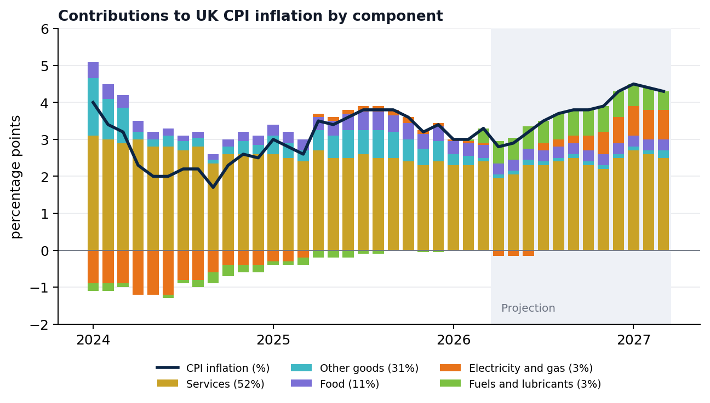
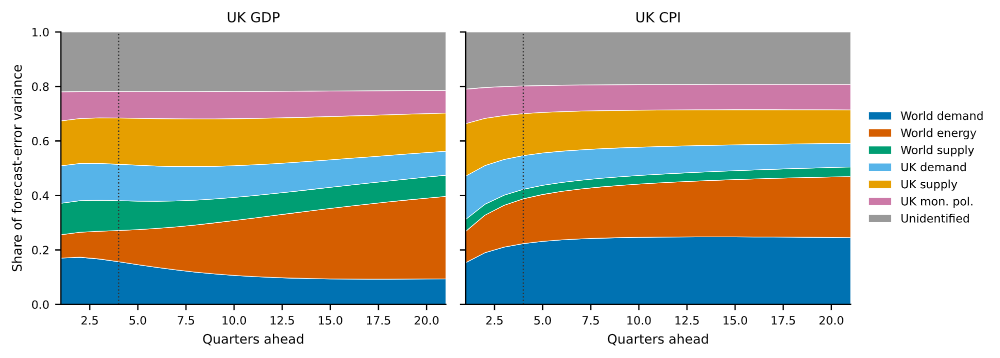

# Bayesian SVAR decomposition of UK CPI inflation

This is the accounting layer. In the Stage 5 sequence it sits between the HMM regime layer and the expectations module. It splits UK CPI inflation and GDP into world and domestic structural shocks, so we can say how much of the current overshoot is imported and how much is home-grown.
References: Sims (1980); Kilian (2009); Uhlig (2005, *Journal of Monetary Economics*), on sign restrictions; Rubio-Ramírez, Waggoner & Zha (2010, *Review of Economic Studies*); BoE Technical Paper 3, as cited in our deck.

## Question it answers

How much of the forecast-error variance in UK CPI inflation and GDP comes from world demand, world energy and world supply shocks? How much comes from UK demand, UK supply and UK monetary policy? The local projections (LP) give us the horizon-by-horizon response to Brent that the scenarios condition on (see the LP memo). The SVAR answers a different question, about attribution, and that needs all the variables in one system.

## Specification

Reduced-form VAR in a vector $`y_t`$ of world activity, world energy and non-energy prices, UK GDP, UK CPI and Bank Rate:

```math
y_t = c + \sum_{\ell=1}^{p} A_\ell\, y_{t-\ell} + u_t, \qquad u_t = B_0^{-1}\varepsilon_t, \qquad \mathbb{E}[\varepsilon_t\varepsilon_t'] = I .
```

We estimate it with Bayesian methods. For each posterior draw of $`(A, \Sigma_u)`$ we draw a random orthogonal rotation $`Q`$ (Rubio-Ramírez, Waggoner & Zha, 2010). We keep the candidate impact matrix $`B_0^{-1} = \operatorname{chol}(\Sigma_u)\,Q`$ only if its impact responses satisfy the signs below (Uhlig, 2005).

| Shock | Oil / world prices | World output | UK GDP | UK CPI | Bank Rate |
|---|---|---|---|---|---|
| World demand | + | + | + | + | |
| World energy | oil + | − | − | + | |
| World supply | − | + | + | − | |
| UK demand | 0 | 0 | + | + | + |
| UK supply | 0 | 0 | + | − | |
| UK monetary policy | 0 | 0 | − | − | + |

Demand shocks move output and prices in the same direction, and supply shocks move them in opposite directions. An energy shock raises the oil price and CPI and lowers GDP. A monetary shock raises Bank Rate and lowers output and CPI. The UK is a small open economy, so UK shocks leave world variables unchanged on impact. Whatever variance these six shocks do not capture is reported as *unidentified*.

The FEVD at horizon $`h`$ is computed draw by draw and summarised by the posterior median:

```math
\omega_{ij}(h) = \frac{\sum_{s=0}^{h-1}\Theta_{s,[ij]}^2}{\sum_{k}\sum_{s=0}^{h-1}\Theta_{s,[ik]}^2}, \qquad \Theta_s = \Psi_s B_0^{-1}.
```

For the comparison with LP only, we also run a monthly recursive VAR on the LP data (oil $`\to`$ energy CPI $`\to`$ CPI $`\to`$ Bank Rate, Cholesky). It is a benchmark for the oil impulse response and plays no part in the decomposition.

## Data

UK CPI all items (ONS `D7BT`), UK real GDP (ONS `ABMI`), Bank Rate, Brent in USD (EIA `RBRTE`), plus world activity and price series. The recursive benchmark uses the LP sample: monthly, 1997-01 to 2026-02, CPI m/m series with month-of-year means removed.

## What the SVAR has to explain



*Contributions to UK CPI inflation by component, January 2024 to early 2027, projection shaded from August 2026. Weights: services 52%, other goods 31%, food 11%, electricity and gas 3%, fuels and lubricants 3%. Approximate data from the Bank of England and ONS.*

Services carry most of the level, about 2.3–2.7pp of contribution throughout. Energy and fuels were a drag in 2024 and turn into a positive contribution through 2026–27. Headline CPI rises toward about 4.5% at the turn of 2027. The chart shows the composition of inflation; the decomposition below is needed to say what drove it.

## Key result



Shares read off the figure, so treat them as approximate.

| Shock | UK CPI, 4 quarters | UK CPI, 20 quarters | UK GDP, 20 quarters |
|---|---|---|---|
| World demand | about 22% | about 24% | about 9% |
| World energy | about 17% | about 22% | about 30% |
| World supply | about 3% | about 3% | about 8% |
| UK demand | about 12% | about 9% | about 9% |
| UK supply | about 15% | about 12% | about 14% |
| UK monetary policy | about 10% | about 10% | about 8% |
| Unidentified | about 20% | about 19% | about 21% |

- At five years, world shocks account for about half of the forecast-error variance of UK CPI. World demand and world energy do most of that work.
- Energy's share of GDP variance keeps rising with the horizon and reaches about 30% at 20 quarters. Energy shocks hit output for longer than they hit prices.
- Monetary policy explains about 10% of CPI variance at both horizons. Most of what the MPC faces therefore comes from shocks it did not create.
- Recursive VAR benchmark: a 10% Brent (USD) shock raises CPI inflation by 0.35pp at month 11 and 0.33pp at month 12, against 0.37pp and 0.36pp from LP. Each IRF sits inside the other's 68% band (figure `figures/lp_vs_svar_irf.png`).

## Why this method

Attribution needs a system in which shocks add up, and horizon-by-horizon LP regressions do not give one. Sign restrictions let us name economically distinct shocks, such as an energy shock versus a world demand shock, without imposing a timing ordering we cannot defend. The Bayesian setup carries parameter and rotation uncertainty through to the FEVD. Recursive timing is still useful as a cross-check on the oil response, because it is transparent and comparable with LP. In population, LP and VARs estimate the same impulse responses (Plagborg-Møller & Wolf, 2021). In finite samples LP accepts more variance in exchange for less bias under misspecification (Li, Plagborg-Møller & Wolf, 2024). On our oil response the two give similar answers.

## Limits

- Sign restrictions set-identify the model. Many rotations fit, so the FEVD shares depend on the restrictions and on the prior over rotations (Baumeister & Hamilton, 2019).
- About a fifth of variance stays unidentified. World supply is small and probably mixes several things.
- The model is linear with constant parameters, over a sample that includes 2008, 2020 and 2022. The HMM regime layer is there to catch breaks that the SVAR averages over.
- Lower-frequency data miss intra-month energy moves. A plain monthly VAR nowcast for March 2026 gave 3.07% against a 3.3% outturn, because it missed the March Brent jump. For this reason the production nowcast uses MIDAS with daily data.
